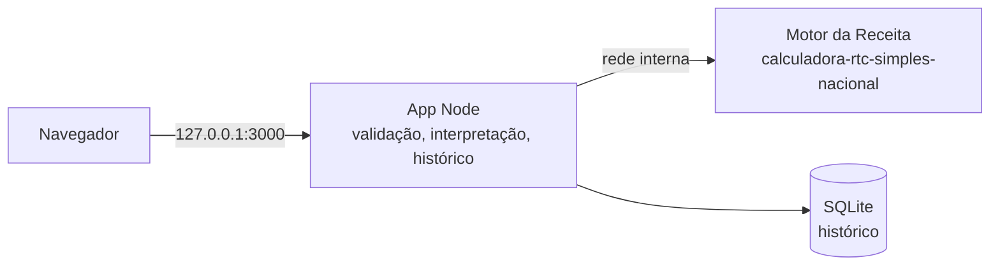

# Tributo Claro

Simulador de **CBS e IBS para empresas do Simples Nacional** (Reforma Tributária do Consumo, LC 214/2025).
A pessoa informa os itens de uma operação e vê, item a item, a estimativa de CBS e IBS, com o estado
de cada cálculo, os avisos do motor e a versão do motor e das tabelas usadas. Cada simulação fica num histórico.

> **Simulação, não apuração oficial.** Os valores são estimativas feitas a partir dos dados informados
> e não representam imposto devido nem valor a pagar. O Tributo Claro usa a calculadora pública da Reforma
> Tributária publicada pela Receita Federal, mas **não é um produto oficial, homologado ou endossado pela
> Receita Federal**. A revisão por um profissional de contabilidade continua essencial.

## O que esta versão faz

- Formulário com data, documento (NF-e/NFC-e), regime do Simples e itens.
- Lista oficial das atividades do Simples (cAtivSN) vigentes na data, vinda do motor.
- Chamada ao motor [`calculadora-rtc-simples-nacional`](https://github.com/ReceitaFederal/calculadora-rtc-simples-nacional),
  rodando como serviço interno, sem acesso pela internet.
- Leitura do **estado de cada item**: um HTTP 200 do motor não quer dizer que tudo foi calculado.
  Estados: `CALCULADO`, `NAO_CALCULADO`, `NAO_IMPLEMENTADO`, `INCONSISTENCIA_ENTRADA` e `FALHA_TECNICA`.
- Totais só dos itens calculados, com alerta quando a simulação é parcial.
- Histórico com a entrada, o que foi enviado ao motor, a resposta e as versões do motor (`X-CALC-APP-VERSION`, `X-CALC-DB-VERSION`).

### Fora do escopo desta versão

Login e usuários, cadastro de empresas, importação de XML, Regime Regular, DANFSe, emissão ou transmissão de
qualquer documento, apuração, guias e pagamentos.

## Lista oficial de cClassTrib

Quem não conhece os códigos escolhe o cClassTrib numa lista com descrição. A lista vem da tabela oficial
`CLASSIFICACAO_TRIBUTARIA` do banco do motor e usa o mesmo filtro do motor: só IBS/CBS, vigente na data da
operação e admitida no tipo de documento. Cada código mostra também o tipo de receita bruta e quanto da receita
entra na base de IBS/CBS, conforme a tabela `TIPO_RECEITA_BRUTA_SIMPLES_NACIONAL`.

- A lista é gerada na montagem da imagem (`scripts/extrair-catalogo.mjs`), a partir do banco da imagem do motor,
  e por isso acompanha a versão do motor. Fora do Docker, sem o arquivo, o campo fica livre.
- `config/mais-usados.json`: lista opcional de códigos destacados no topo como "Mais usado pela C&S". Começa
  vazia, e só entram códigos indicados pelo responsável técnico; código que não está na tabela oficial é ignorado.

## Como rodar (Docker)

Precisa de Docker com Compose e de internet na **primeira** montagem: a imagem do motor baixa o código
oficial num commit fixado e as dependências Maven.

```bash
docker compose up --build
```

A imagem do app só monta pelo `docker compose`: ela copia o banco da imagem do motor (contexto adicional
`motor: service:motor`) para gerar a lista de cClassTrib. Um `docker build .` direto falha nesse passo, de propósito.

Abra http://localhost:3000. A primeira montagem do motor leva alguns minutos.

- O motor fica numa rede interna, sem porta no computador e sem saída para a internet.
- O app só escuta em `127.0.0.1:3000`, então não aparece para a rede local.
- O histórico fica no volume `historico`. Para apagar: `docker compose down -v`.

## Como rodar sem Docker (desenvolvimento)

Requer Node 24 ou mais novo. O app não tem dependências externas.

```bash
npm test                                  # testes, com um motor falso
MOTOR_URL=http://127.0.0.1:8082/api npm start
```

Para o motor real, siga o README do repositório da Receita (Java 21; banco gerado pelos scripts Flyway
do repositório `calculadora-rtc-regime-regular`, como faz o `motor/Dockerfile`).

| Variável | Padrão | Para quê |
|---|---|---|
| `HOST` | `127.0.0.1` | Endereço em que o app escuta |
| `PORTA` | `3000` | Porta do app |
| `MOTOR_URL` | `http://127.0.0.1:8082/api` | Endereço interno do motor |
| `HISTORICO_ARQUIVO` | `./dados/historico.db` | Arquivo SQLite do histórico |
| `HOSTS_PERMITIDOS` | `localhost:PORTA,127.0.0.1:PORTA` | Valores aceitos no cabeçalho Host/Origin |

Nenhuma variável é secreta. Não coloque credenciais neste repositório.

## Arquitetura



- `src/validacao.mjs`: valida o formato da entrada. A validação tributária é do motor (códigos `VSN-`).
- `src/motor.mjs`: adaptador do motor. Monta o contrato, chama com tempo limite e interpreta item a item.
- `src/historico.mjs`: histórico em SQLite (`node:sqlite`).
- `src/servidor.mjs`: rotas HTTP, arquivos da tela e cabeçalhos de segurança.
- `motor/Dockerfile`: compila o motor oficial e gera o banco de tabelas.

O contrato do motor foi lido do código-fonte no commit fixado (`OperacaoSimplesInput`, `ObservabilidadeSimplesDomain`),
e não da documentação de exemplos, que em parte se refere ao Regime Regular. Detalhes em [docs/CONTRATO_MOTOR.md](docs/CONTRATO_MOTOR.md).

## Segurança

- **Sem login nesta versão.** Use só no próprio computador. Para expor em rede ou na internet, é preciso
  antes autenticação, HTTPS, limite de requisições e histórico separado por usuário (hoje quem abre a tela
  vê as 50 últimas simulações).
- O histórico guarda no máximo 1.000 simulações; as mais antigas são apagadas.
- Só aceita requisições com `Host`/`Origin` da lista permitida (proteção contra DNS rebinding e contra outros sites).
- O `POST` exige `application/json` e limita o corpo a 64 KB.
- CSP restritiva, sem script inline; a tela insere texto só por `textContent`.
- O formulário não pede dado pessoal (CNPJ, nome ou e-mail).
- Imagens-base fixadas por digest; containers sem privilégios, com sistema de arquivos só de leitura.

## Créditos e licenças

O cálculo é feito pela [calculadora-rtc-simples-nacional](https://github.com/ReceitaFederal/calculadora-rtc-simples-nacional),
com o banco gerado pelos scripts de [calculadora-rtc-regime-regular](https://github.com/ReceitaFederal/calculadora-rtc-regime-regular),
ambos © 2026 Receita Federal do Brasil, licença MIT. Este repositório não contém código desses projetos; a imagem
do motor os compila a partir da fonte oficial e inclui os textos de licença em `/motor/licencas`. Veja [NOTICE.md](NOTICE.md).

Este repositório ainda não tem licença de uso definida: o código está visível, mas todos os direitos ficam reservados até essa decisão.
